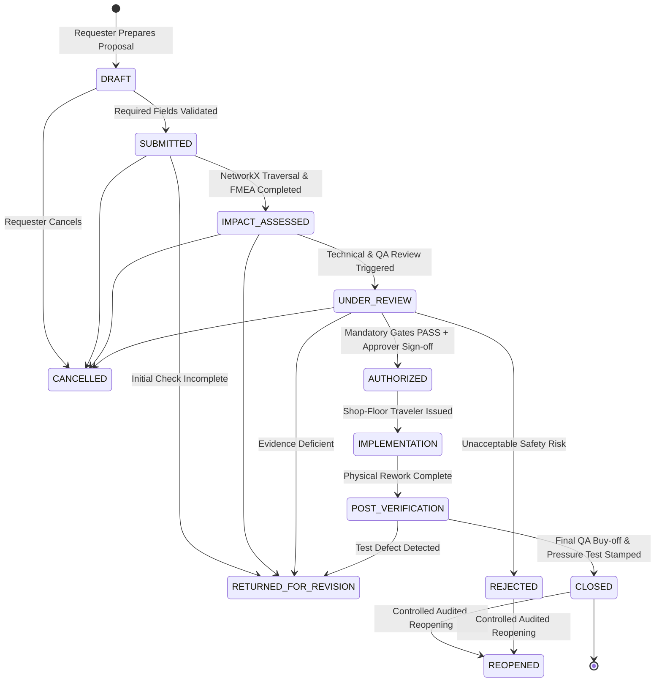
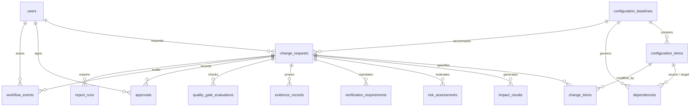

# ChangeLens — System Architecture & Data Model Specification
**Modular Monolith Architecture, Relational Schema, and Engine Interfaces**  
*Document Version: 1.0 · Date: 19 October 2026*

---

## 1. System Architecture Overview

ChangeLens is engineered as a clean **modular monolith**: a single cohesive application combining a typed React frontend, an asynchronous FastAPI backend service, an embedded deterministic graph intelligence layer (NetworkX), and an auditable relational database (SQLite in development, PostgreSQL ready for production).

```mermaid
flowchart TD
    subgraph UI["ChangeLens Web Interface (React 19 + TypeScript + Vite)"]
        DASH["Overview Dashboard (KPIs & Visualizations)"]
        WS["Change Workspace (Side-by-side Baseline Diff)"]
        EXP["Impact Explorer (@xyflow/react Interactive Graph)"]
        RISK["Risk Register (FMEA S/O/D & High-Severity Alerts)"]
        GATE["Quality Gates & Evidence Verification Checklist"]
        QUEUE["Review Queue (Separation-of-Duties Approvals)"]
        RPT["Reports & Multi-Format Exports (PDF/DOCX/XLSX/CSV)"]
        ILM["ILM Case Study & Decision Matrix"]
    end

    subgraph API["FastAPI Application Services (/api/v1)"]
        ROUTER["API Router & CORS Gateway"]
        IMP_ENG["Impact Engine (NetworkX Rule-Directed Traversal)"]
        RISK_ENG["Risk Engine (FMEA & Adaptive Rules)"]
        GATE_ENG["Quality Gate Engine (Deterministic Pre-conditions)"]
        WF_ENG["Workflow Engine (Separation of Duties & State Machine)"]
        AUD_SVC["Audit Service (Append-only Event Logger)"]
        RPT_ENG["Report Generator (ReportLab, docx, openpyxl, pandas)"]
        ANALYTICS["Analytics Engine (KPI Calculations & Recharts Feeds)"]
    end

    subgraph DB["Relational Persistence Layer (SQLAlchemy 2.0)"]
        USERS[("users")]
        BASELINES[("configuration_baselines & items")]
        DEPS[("dependencies")]
        CHANGES[("change_requests & change_items")]
        IMPACTS[("impact_results")]
        RISKS_DB[("risk_assessments")]
        EVIDENCE[("verification_requirements & evidence_records")]
        GATES_DB[("quality_gate_evaluations")]
        APPROVALS[("approvals")]
        EVENTS[("workflow_events (Audit Trail)")]
        REPORTS_DB[("report_runs")]
    end

    UI -->|HTTP / REST API Contracts| API
    API -->|ORM Transactions & Constraints| DB
```

---

## 2. Workflow State Machine & Governance

### Separation of Duties Rules
1. **Requester Self-Approval Prohibition**: The user who author-created a change request cannot submit an `APPROVED` decision for that request (`validate_approval` returns `403 Forbidden`).
2. **Requester Self-Authorization Prohibition**: The author cannot transition the change request to `AUTHORIZED` or perform independent final verification to `CLOSED` (`AC-05`).
3. **Auditor Immutability**: Users with the `AUDITOR` role have read-only access to audit logs and system analytics and are strictly blocked from triggering state transitions or submitting approvals.

---

## 3. Relational Database Schema (Entity-Relationship Model)

### Core Entities Description
- **`users`**: User identity, role (`REQUESTER`, `ENGINEER_QA`, `APPROVER`, `AUDITOR`), contact information, and active flag.
- **`configuration_baselines`**: Unique configuration baseline identity (`BASE-737-9-DOORPLUG-A`), version (`Rev A.1`), status (`ACTIVE`, `SUPERSEDED`), and release date.
- **`configuration_items`**: Linked nodes representing components (`C-104`), specifications (`S-201`), processes (`P-301`), inspections (`I-401`), and tests (`T-501`) with criticality ratings (`CRITICAL`, `MAJOR`, `STANDARD`).
- **`dependencies`**: Typed directed relationships between items (`SPECIFIED_BY`, `MANUFACTURED_BY`, `ASSEMBLED_INTO`, `SECURED_BY`, `INSPECTED_BY`, `VERIFIED_BY`, `DEPENDS_ON`).
- **`change_requests`**: Change proposal header (`CCR-2026-0001`), title, justification, change category, baseline reference, and current workflow state.
- **`change_items`**: Field-level delta definitions (e.g. `material_specification`, baseline value vs proposed value, operation `MODIFY`).
- **`impact_results`**: Persisted outcomes of NetworkX traversal: reachable object ID, classification (`DIRECTLY_CHANGED`, `POTENTIALLY_IMPACTED`, `VERIFICATION_REQUIRED`), path JSON, propagation rule, rationale, and baseline revision snapshot.
- **`risk_assessments`**: AIAG/VDA FMEA records with Severity ($S$), Occurrence ($O$), Detection ($D$), calculated $RPN = S \times O \times D$, $S \ge 8$ high-severity escalation flag, mitigation, owner, and residual risk.
- **`verification_requirements`**: Adaptively generated mandatory checklist items linked to airworthiness criteria, change types, and high-severity triggers.
- **`evidence_records`**: Digital evidence records with source document references, revision numbers, file metadata, cryptographic SHA-256 integrity hash, and QA verification status (`ACCEPTED`, `REJECTED`, `PENDING_REVIEW`).
- **`quality_gate_evaluations`**: Evaluation outcomes across gate milestones returning structured status (`PASS`, `BLOCKED`, `REVIEW_REQUIRED`), evaluated checks JSON, explicit blocking reasons JSON, and actionable corrective steps JSON.
- **`approvals`**: Formal governance decisions submitted by authorized reviewers with binding rationale and timestamp.
- **`workflow_events`**: Append-only audit trail logging actor, role, action, previous state, new state, reason, and metadata.
- **`report_runs`**: Catalog of generated engineering reports with template versions, input snapshot hashes, and disk paths for PDF, DOCX, XLSX, and CSV exports.
