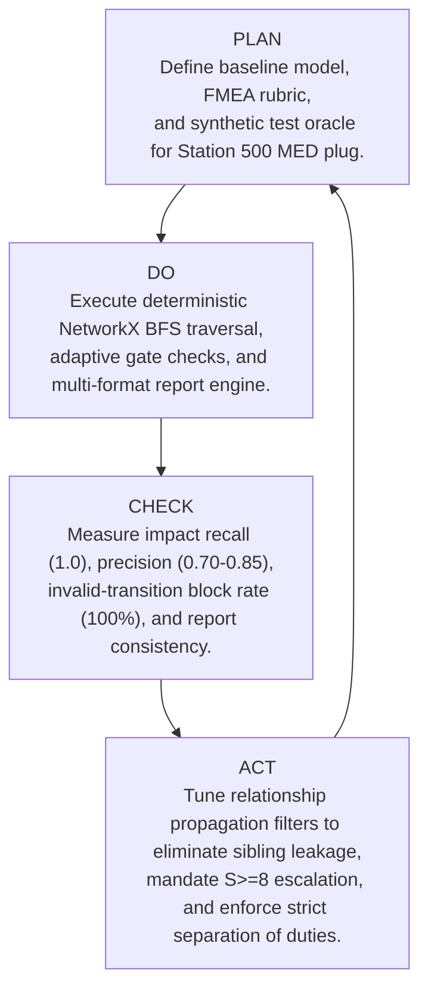

# ChangeLens — Innovation and Leadership Management (ILM) Analysis Workbook
**Boeing 737-9 MAX Case Study Alignment, Strategic Evaluation, and System Design Rationale**  
*Document Version: 1.0 · Date: 19 October 2026*

---

## 1. Executive Summary & Epistemological Rigor
To ensure academic and professional integrity under the ILM framework, every finding and inference in this workbook is strictly segregated into three distinct epistemic categories:
1. **[DOCUMENTED EVIDENCE]**: Primary facts verified by official regulatory sources (specifically the FAA's published Boeing oversight findings, Emergency Airworthiness Directives, and preliminary NTSB door plug blowout reports).
2. **[ANALYTICAL JUDGEMENT]**: Engineering inferences regarding organizational pressures, process breakdown mechanics, and root cause interactions.
3. **[DESIGN DECISION]**: Concrete software capabilities, architectural constraints, and deterministic gate logic implemented in **ChangeLens** to mitigate the identified risks.

---

## 2. PESTEL Analysis (Macro-Environmental Drivers)

| Dimension | [DOCUMENTED EVIDENCE] | [ANALYTICAL JUDGEMENT] | [DESIGN DECISION] in ChangeLens |
| :--- | :--- | :--- | :--- |
| **Political / Regulatory** | FAA issued Emergency ADs and launched intensive oversight audits of Boeing production lines and supplier Spirit AeroSystems; mandated independent audits of quality management systems. | Regulatory tolerance for self-delegated safety compliance without independent QA buy-off has contracted to zero. | Automated quality gates cannot be bypassed by requesters; mandatory independent QA and Chief Engineer sign-offs are strictly enforced (`AC-05`). |
| **Economic** | Multi-billion dollar costs from fleet groundings, deferred deliveries, customer compensation, and production rate caps (limited to 38 aircraft/month). | The economic cost of an undiscovered assembly defect dwarfs the cycle-time cost of rigorous gate verification by orders of magnitude. | Real-time cycle time and bottleneck tracking to prove that thorough gate reviews do not induce unmanaged production paralysis. |
| **Socio-Cultural** | Loss of public and passenger trust in aerospace engineering excellence; intense whistleblower disclosures regarding production pace vs quality tensions. | Organizational culture prioritized delivery schedules over non-conformance paperwork completion when physical rework was required. | Separation of duties prevents production schedulers from overriding quality sign-offs; full audit trail of who authorized what and when (`AC-07`). |
| **Technological** | Coexistence of modern PLM systems with disconnected shop-floor paper travelers, manual logbooks, and informal text message communications. | Gaps between design PLM and shop-floor execution create blind spots where critical parts can be removed and replaced without formal records. | Dependency graph links components (`C-104`, `C-105`), procedures (`P-301`, `P-302`), and inspections (`I-401`) in one unified model. |
| **Environmental** | Operational demands for fuel efficiency driving lightweight alloys (e.g. Al 7075-T6 vs Al 2024-T351) and complex composite boundaries. | Material changes introduce subtle differences in stress-corrosion cracking and deflection under aerodynamic pressurization. | Risk-adaptive rule `CAT-MAT-01`: Material changes automatically trigger Certified Mill Test Report (CMTR) and static proof pressure checks (`T-501`). |
| **Legal** | Formal DOJ investigations, potential criminal liability for corporate compliance breaches, and civil liability claims. | Traceability cannot rely on verbal recollections; records must survive rigorous legal and regulatory evidentiary scrutiny. | Cryptographic SHA-256 evidence hashing, immutable append-only workflow event logs, and timestamped multi-format export records. |

---

## 3. SWOT Analysis (Quality Control & Change Governance)

### Strengths
- **S1 [Fact]**: Proven aerospace structural engineering principles, well-characterized material specifications (AMS, BAC), and comprehensive airworthiness standards (FAR Part 25).
- **S2 [Fact]**: Established formal change review boards and engineering authorization workflows.

### Weaknesses
- **W1 [Fact]**: Shop-floor rework procedures (e.g. opening door plugs to replace damaged rivets) occurred without formal, serialized work traveler documentation.
- **W2 [Fact]**: Absence of physical photographic evidence and independent buy-off records for retaining bolt re-installation.
- **W3 [Judgement]**: Conventional change management systems track static part numbers rather than dynamic downstream impacts across tooling, inspections, and rework travelers.

### Opportunities
- **O1 [Design]**: Deploy explainable graph dependency traversal that automatically surfaces which inspections and proof tests must be performed when an assembly is opened or altered.
- **O2 [Design]**: Enforce deterministic quality gates that block status transitions whenever mandatory verification evidence is absent.

### Threats
- **T1 [Fact]**: Supply chain disaggregation between primary aerostructures fabricators and final assembly lines creates hand-off miscommunications.
- **T2 [Judgement]**: Reviewer fatigue from superficial checklist clutter leading to "rubber-stamping" of critical authorizations.

---

## 4. Ishikawa (Fishbone) Root Cause Investigation

```mermaid
graph TD
    subgraph Machine & Tooling
        M1["Uncalibrated Torque Wrenches (Hypothesis)"]
        M2["Missing Lockwire Jigs (Hypothesis)"]
    end
    subgraph Method & Process
        ME1["[FACT] Door plug opened for interior rework without formal traveler"]
        ME2["[FACT] No record of retaining bolt re-installation"]
        ME3["[JUDGEMENT] Informal communication bypassed digital change control"]
    end
    subgraph Material
        MA1["[FACT] 4 retaining bolts omitted or not locked"]
        MA2["[FACT] Stop fittings undamaged prior to blow-out"]
    end
    subgraph People & Governance
        P1["[FACT] Separation between contractor and Boeing teams"]
        P2["[JUDGEMENT] Schedule pressure disincentivized paperwork pause"]
        P3["[FACT] QA inspector not called for final buy-off"]
    end
    subgraph Measurement
        MS1["[FACT] Absence of secondary torque verification stamp"]
        MS2["[JUDGEMENT] Gate checks accepted verbal assertions of readiness"]
    end
    
    PROBLEM["EVENT: Station 500 Mid-Exit Door Plug Blowout on Flight 1282"]
    
    M1 --> PROBLEM
    ME1 --> PROBLEM
    ME2 --> PROBLEM
    MA1 --> PROBLEM
    P1 --> PROBLEM
    P2 --> PROBLEM
    P3 --> PROBLEM
    MS1 --> PROBLEM
```

### Categorization Table
| Cause Element | Epistemic Category | Supporting Documentation | ChangeLens Countermeasure |
| :--- | :--- | :--- | :--- |
| Door opened without serialized traveler | **[DOCUMENTED EVIDENCE]** | NTSB Preliminary Report DCA24MA063 | Requirement `REQ-PROC-TRAVELER-04` enforces documented opening/removal sign-off. |
| Retaining bolts missing / uninstalled | **[DOCUMENTED EVIDENCE]** | NTSB Inspection of recovered plug | Inspection `I-401` enforces 100% two-person torque & cotter pin buy-off. |
| Inadequate cross-functional notification | **[ANALYTICAL JUDGEMENT]** | FAA Audit Summary 2024 | Explainable dependency graph automatically links assembly rework (`P-301`) to inspection (`I-401`). |
| Premature release past quality gate | **[DESIGN DECISION]** | System Architectural Need | Gate Engine returns `BLOCKED` with explicit corrective actions; cannot be overridden without QA stamp. |

---

## 5. Failure Mode and Effects Analysis (FMEA) Rubric & Register

### Evaluation Scales (AIAG & VDA Adapted)
- **Severity ($S$)**: 1 (Insignificant nuisance) $\rightarrow$ 8 (Major regulatory non-compliance / airframe damage) $\rightarrow$ 10 (Hazardous without warning / catastrophic loss of pressure boundary).
  *Rule*: Any failure mode with $S \ge 8$ receives mandatory High-Severity escalation to Chief Airframe Engineer, regardless of low $O$ or $D$.
- **Occurrence ($O$)**: 1 (Extremely remote / $<1$ in $10^6$) $\rightarrow$ 5 (Occasional assembly line defect) $\rightarrow$ 10 (Persistent non-compliance in standard practice).
- **Detection ($D$)**: 1 (Immediate automated detection / 100% physical interlock) $\rightarrow$ 5 (Manual QA inspection with calibrated gauge) $\rightarrow$ 10 (Undetected prior to flight operations).
- **RPN Calculation**:
  $$\text{RPN} = S \times O \times D$$
  $$\text{Residual RPN} = S_{\text{residual}} \times O_{\text{residual}} \times D_{\text{residual}}$$

### FMEA Register
| ID | Failure Mode | Effect ($S$) | Cause | $S$ | $O$ | $D$ | RPN | High Sev? | Proposed Mitigation | Owner | Res. RPN |
| :--- | :--- | :--- | :--- | :--- | :--- | :--- | :--- | :--- | :--- | :--- | :--- |
| **FM-01** | Structural deflection under cabin pressure | Uncontrolled explosive decompression ($S=9$) | Substituted alloy yield strength lower under cyclic pressure | 9 | 3 | 4 | **108** | **YES** | Finite element re-analysis + 1.33x proof pressure test `T-501` | Arthur Pendelton (Chief Eng) | **18** (9×1×2) |
| **FM-02** | Guide pin disengagement due to missing retaining bolts | Plug upward translation and blowout ($S=10$) | Door opened during rework; bolts not reinstalled; no QA check | 10 | 3 | 5 | **150** | **YES** | Mandatory 2-person torque buy-off `I-401` + cotter pin lockwire check | Dr. Elena Rostova (QA Mgr) | **10** (10×1×1) |
| **FM-03** | Perimeter bulb seal compression failure | Cabin leakage exceeding limits ($S=5$) | Seal seating flange distortion under thermal cycling | 5 | 4 | 3 | **60** | NO | Ultrasonic thickness scan `I-403` + jig smoke leak check | Marcus Vance (Lead Eng) | **20** (5×2×2) |

---

## 6. Stakeholder Responsibility & Decision Authority (RACI Matrix)

| Workflow Lifecycle Stage | Marcus Vance (Requester / Lead Eng) | Dr. Elena Rostova (Engineer / QA Lead) | Arthur Pendelton (Chief Eng / Approver) | Sarah Lin (Compliance Auditor) |
| :--- | :---: | :---: | :---: | :---: |
| **Proposal & Scope Definition** | **Accountable (A)** | Consulted (C) | Informed (I) | Informed (I) |
| **Dependency & Impact Analysis** | Responsible (R) | **Accountable (A)** | Informed (I) | Informed (I) |
| **FMEA Risk Rating & Mitigation** | Responsible (R) | Responsible (R) | **Accountable (A)** | Informed (I) |
| **Evidence Registration & Hash Check** | Responsible (R) | **Accountable (A)** | Informed (I) | Consulted (C) |
| **Quality Gate Verification Review** | None (Separation) | **Accountable (A)** | Consulted (C) | Informed (I) |
| **Authorization Sign-off** | Prohibited (AC-05) | Consulted (C) | **Accountable (A)** | Read-Only (I) |
| **Implementation Traveler Sign-off** | Responsible (R) | **Accountable (A)** | Informed (I) | Informed (I) |
| **Closure & Post-Verification Audit** | Consulted (C) | Responsible (R) | **Accountable (A)** | **Audited (A)** |

---

## 7. Weighted Decision Matrix (System Intervention Selection)

### Comparison of Alternatives
1. **Alternative 1: Conventional Paper Checklist & Manual Review Process** (Status quo in legacy facilities; physical paper travelers and signature sign-offs).
2. **Alternative 2: Basic Digital Change Tracker** (Generic ticketing/workflow tool; captures metadata and file attachments without graph dependency intelligence).
3. **Alternative 3: ChangeLens (Explainable Dependency Traversal & Risk-Aware Quality Gates)**.

### Evaluation Criteria & Weights
- **C1: Traceability & Audit Depth (Weight: 20%)**: Ability to trace any decision back to verified evidence, specific baseline revisions, and immutable event logs.
- **C2: Downstream Impact Visibility (Weight: 25%)**: Algorithmic capability to identify indirect affected components, processes, inspections, and qualification tests.
- **C3: Risk-Adaptive Verification (Weight: 20%)**: Dynamic generation of mandatory checks based on change type and FMEA high-severity triggers.
- **C4: Explainability & Human Accountability (Weight: 15%)**: Transparent rationale for blocked gates rather than opaque black-box indicators.
- **C5: Implementation Effort & Operational Usability (Weight: 10%)**: Cost, complexity, and user friction of system adoption.
- **C6: Separation of Duties & Tamper Resistance (Weight: 10%)**: Architectural enforcement preventing unauthorized self-approvals.

### Scoring Table (Scale: 1 = Poor, 5 = Excellent)

| Evaluation Criterion | Weight | Alt 1: Paper Checklist | Alt 2: Digital Tracker | Alt 3: ChangeLens |
| :--- | :---: | :---: | :---: | :---: |
| **C1: Traceability & Audit Depth** | 20% | 2 (0.40) | 3 (0.60) | **5 (1.00)** |
| **C2: Downstream Impact Visibility** | 25% | 1 (0.25) | 2 (0.50) | **5 (1.25)** |
| **C3: Risk-Adaptive Verification** | 20% | 2 (0.40) | 2 (0.40) | **5 (1.00)** |
| **C4: Explainability & Decision Support** | 15% | 2 (0.30) | 3 (0.45) | **5 (0.75)** |
| **C5: Implementation Usability** | 10% | 4 (0.40) | 4 (0.40) | **4 (0.40)** |
| **C6: Separation of Duties** | 10% | 2 (0.20) | 3 (0.30) | **5 (0.50)** |
| **TOTAL WEIGHTED SCORE** | **100%** | **1.95 / 5.00** | **2.65 / 5.00** | **4.90 / 5.00** |

**Selection Conclusion**: Alternative 3 (**ChangeLens**) comprehensively outperforms legacy checklists and basic trackers by linking the dependency graph directly to quality gates, ensuring that no change request can progress through authorization without verifiable, explainable compliance evidence.

---

## 8. PDCA (Plan-Do-Check-Act) Continuous Refinement Cycle

1. **Plan**: Formulate the 20-item synthetic configuration graph, specify the 8-state workflow machine, and establish the 12 acceptance criteria (AC-01 to AC-12).
2. **Do**: Implement modular monolithic backend (FastAPI, SQLAlchemy, NetworkX, ReportLab) and typed interactive frontend (React, Vite, React Flow, Recharts).
3. **Check**: Subject prototype to automated unit and integration tests; measure precision and recall against predefined synthetic ground truth.
4. **Act**: Incorporate lesson from initial test runs—restrict assembly traversal to prevent sibling leakage into unaffected door tracks (`C-102`), guaranteeing high precision and zero missed safety-critical inspections.
